# NeuroPaw — робособака на нейросетях

Автономная четвероногая собака на четырёх платах ESP32, связанных шиной CAN.
Ходит, слушает голосовые команды, узнаёт хозяина, приносит игрушки, засыпает и учится —
без компьютера и без интернета.

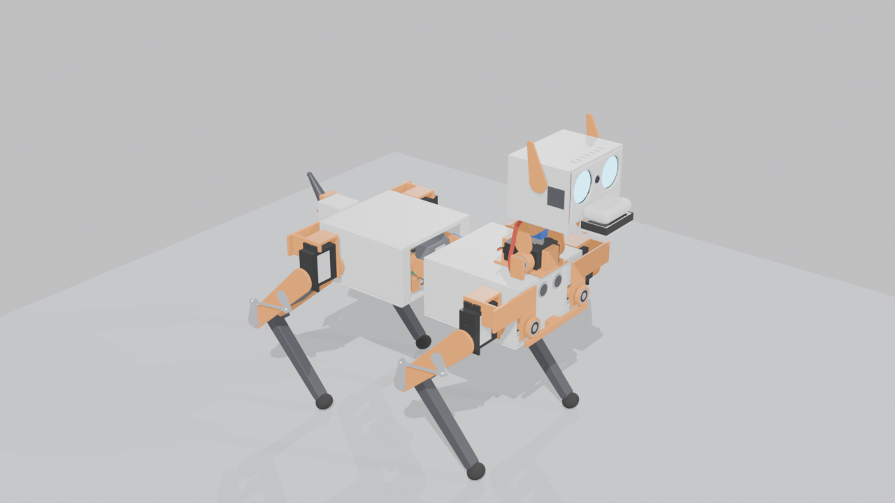

| | |
|---|---|
| Сервоприводов | **20** (12 в ногах, 2 в позвоночнике, хвост, шея ×2, челюсть, уши ×2) |
| Масса (расчёт по модели) | **2.67 кг** |
| Габариты в стойке | **421 × 252 × 374 мм** (длина × ширина × высота до ушей) |
| Высота спины | 220 мм |
| Нога | бедро 110 мм + голень 120 мм, колено через тягу |
| Мозг | 4 × ESP32 на CAN 500 кбит/с, 14 маленьких нейросетей |
| Питание | 2S2P Li-ion (7.2 В, 5600 мА·ч) |
| Время работы | ходьба ≈ 37 мин · стоит ≈ 72 мин · лежит ≈ 5.8 ч |

> Проект на стадии модели: всё ниже — 3D-модель в Blender и расчёты по ней.
> Железо ещё не собрано.

---

## Как он будет выглядеть — четыре версии

Каждая версия — законченная рабочая собака, следующая добавляет ей «жизни».

### Версия 1 — Цифровой щенок

Точная модель в симуляторе MuJoCo: размеры, массы, моменты инерции и характеристики серв
берутся из этой Blender-модели (`docs/sim_params.md`). В симуляторе собака учится стоять,
ходить, поворачивать, садиться, ложиться и вставать после падения.

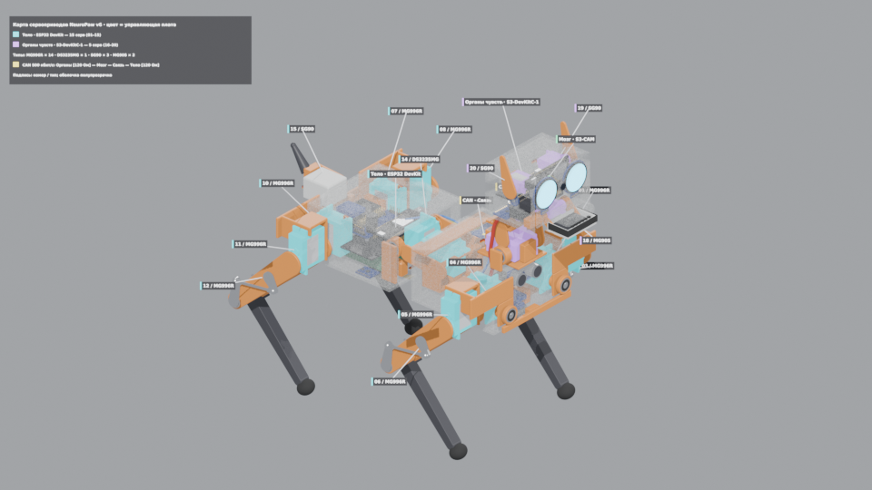

*Цифровая модель: корпус полупрозрачный, сервы окрашены по плате, которая ими управляет
(бирюзовые — «Тело», фиолетовые — «Органы чувств»).*

### Версия 2 — Первые шаги в реальности

Напечатанный корпус, ноги и гибкий позвоночник — 14 серв. Работают платы «Тело» и «Мозг»:
собака сама стоит, ходит, обходит стены и встаёт после падения.

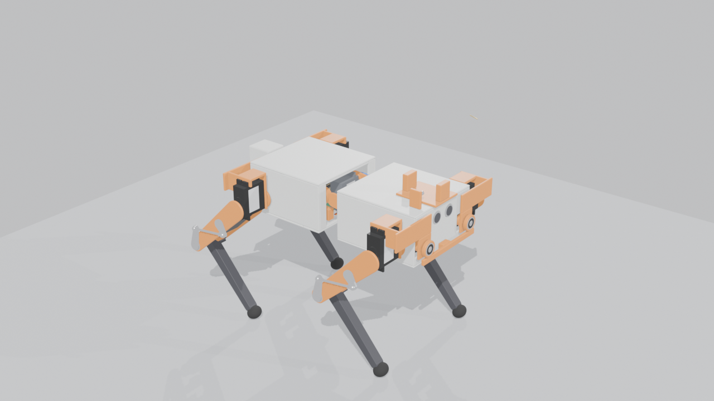

### Версия 3 — Живой характер

Голова с глазами-экранами, камерой, микрофонами, динамиком и пастью, уши, хвост — все 20 серв.
Слышит своё имя, узнаёт хозяина, выполняет голосовые команды офлайн, приносит игрушку.


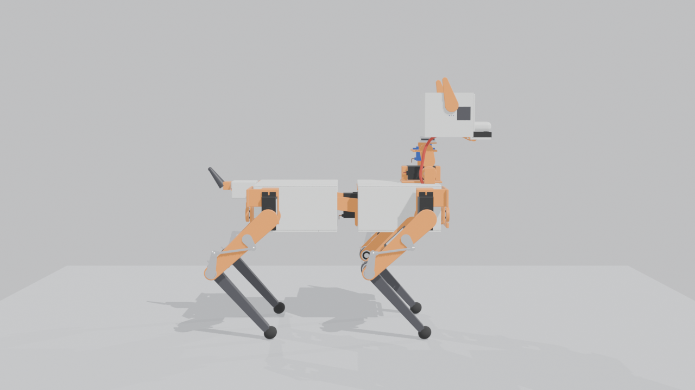

### Версия 4 — Как настоящая собака

Тот же корпус, но новое поведение: дневник опыта, привычки, любимые места, распорядок семьи,
сама ходит заряжаться на док-станцию.

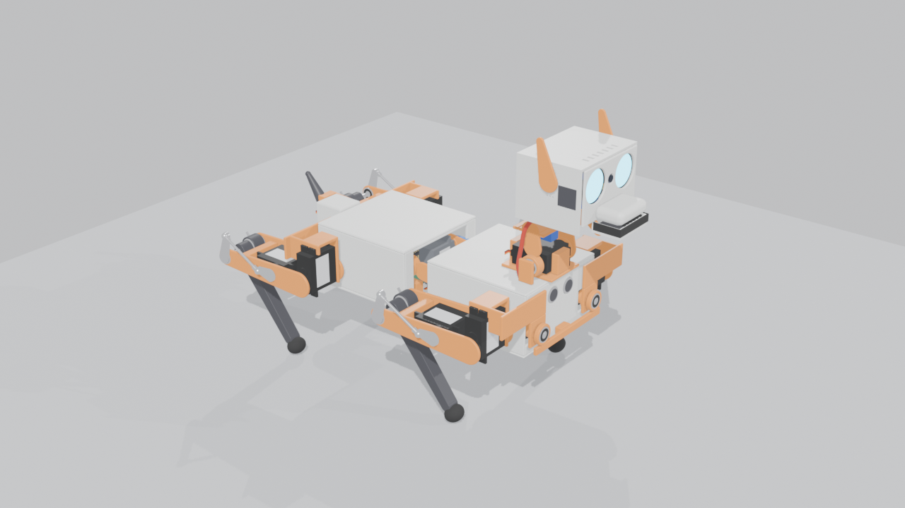

---

## Нервная система

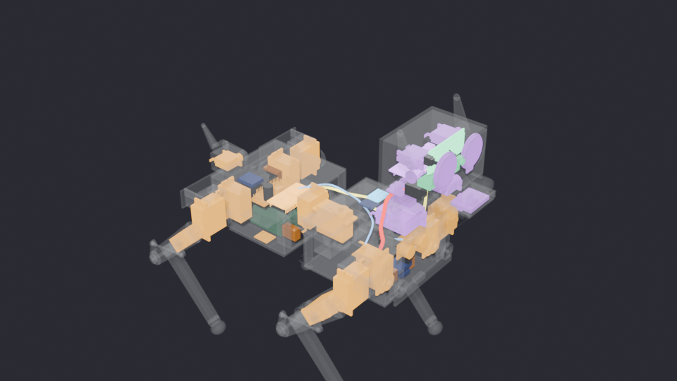

| Плата | Модуль | Где | Отвечает за |
|---|---|---|---|
| Тело | ESP32 DevKit (WROOM-32) | задняя секция | сервы 01–15 через PCA9685, баланс по 2 × MPU-6050, сонар HC-SR04, батарея; ходьба 50 Гц |
| Органы чувств | ESP32-S3-DevKitC-1 N16R8 | голова | слух (2 × INMP441), голос (MAX98357A), глаза GC9A01 × 2, сервы 16–20 |
| Мозг | ESP32-S3-CAM N16R8 | голова, за глазами | зрение (камера в морде), поведение, чувства, память на флешке |
| Связь | ESP32-C3 SuperMini | передняя секция | Wi-Fi, облачная LLM — необязательна, без неё всё работает |

```
Органы чувств [120 Ом] ── Мозг ══ шея ══ Связь ══ позвоночник ══ Тело [120 Ом]
```
CAN 500 кбит/с, 4 × SN65HVD230, загрузка шины ≈ 9 %. Подробно — [`docs/nervous_system.md`](docs/nervous_system.md).

**Нейросети** (~70 % поведения — обычные алгоритмы, остальное — маленькие сети на ESP32-S3):
ходьба и вставание (PPO, обучение в MuJoCo), тип пола по IMU, аномалии тока серв,
имя-«wake word», 10–15 голосовых команд на русском, звуки, детектор лиц и узнавание хозяина
(ESP-DL), детектор игрушки.

---

## Механика

### Сервоприводы и запас по моменту

Запас = момент сервы ÷ нужный момент в худшей позе (цель ≥ 1.8). Полная таблица с каналами
и питанием — [`docs/servo_map.md`](docs/servo_map.md).

| Суставы | Тип | Ход | Запас |
|---|---|---|---:|
| 01, 04, 07, 10 — отведение ног | MG996R | ±30° | **1.8** |
| 02, 05, 08, 11 — бедро | MG996R | ±90° | **2.0** |
| 03, 06, 09, 12 — колено (через тягу + пружина) | MG996R | 65…128° | **2.5** |
| 13 — позвоночник вбок | MG996R | ±15° | 3.2 |
| 14 — позвоночник вверх-вниз | DS3235MG | ±20° | 15.2 |
| 15 — хвост | SG90 | ±60° | 54.7 |
| 16 — шея наклон | MG996R | −30…45° | 4.1 |
| 17 — шея поворот | MG90S | ±90° | 3.2 |
| 18 — челюсть | MG90S | 0…30° | 4.7 |
| 19, 20 — уши | SG90 | ±45° | 226 |

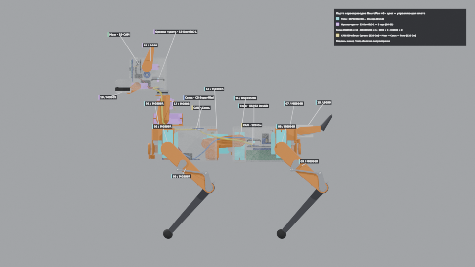

### Колено: четырёхзвенник

Серва колена стоит на оси бедра и крутит колено через тягу — так нога легче, а передача
усиливает момент в **2.09 раза** в стойке (≥ 1.93 на шаге).

| Колено разогнуто (65°) | Колено согнуто (128°) |
|---|---|
| 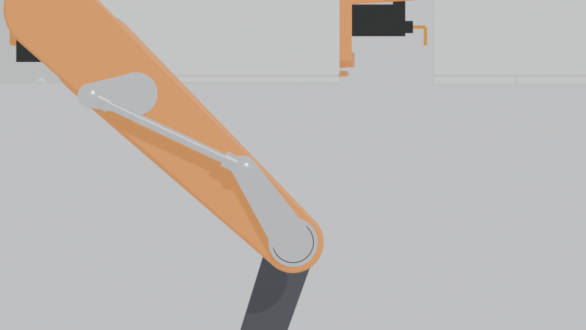 | 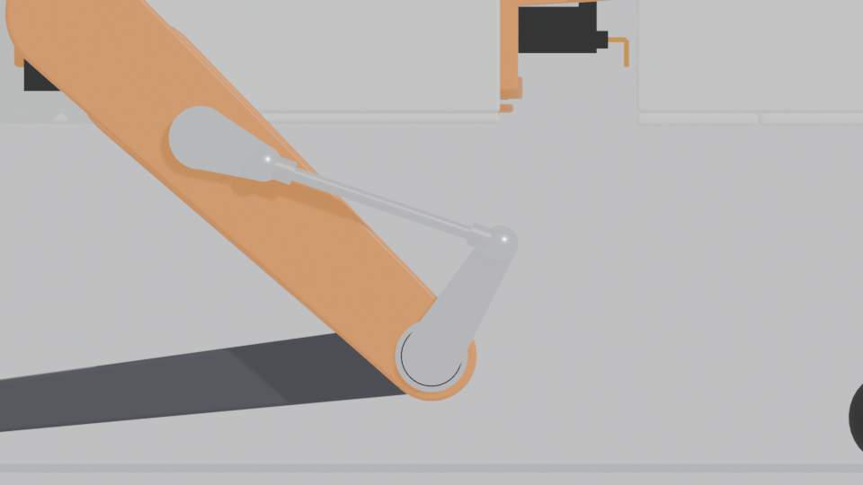 |

- Качалка 15 мм, рычаг 29 мм, тяга 55 мм; угол передачи ≥ 31°.
- Мёртвая точка тяги 130.04° → механический упор 128.5°, рабочий ход 65–128°.
- Подробно — [`docs/knee_linkage.md`](docs/knee_linkage.md).

### Пружина колена

Торсионная пружина помогает разгибать колено (держит вес), серва работает против неё
только при сгибании и в переносе ноги. Подобрана перебором так, чтобы запас был ≥ 1.8 **во всех** позах.

- Проволока пружинная Ø2.0 мм, наружный Ø18 мм, 6 витков, жёсткость 536 Н·мм/рад.
- Предварительный натяг 25° при разогнутом колене; 2 левые + 2 правые навивки.

| Поза | Запас без пружины | С пружиной |
|---|---:|---:|
| Стоит | 4.4 | 35 |
| Рысь (2 ноги, ×1.3 на динамику) | 1.7 | **2.5** |
| Шаг на 3 ногах, стопа вынесена | 1.8 | 2.6 |
| Встаёт из «лежит» | 8.4 | 25 |
| Сидит, задняя нога | 5.2 | 33 |
| Перенос ноги (худший угол) | 41 | 3.0 |

Расчёт по всем позам — [`docs/engineering.md`](docs/engineering.md).

### Масса и центр масс

| Группа | г |
|---|---:|
| Печать PETG | 976 |
| Сервоприводы | 890 |
| Аккумулятор и питание | 309 |
| Подшипники | 118 |
| Электроника | 98 |
| Провода | 83 |
| Оси M5 | 78 |
| Качалки, тяги, рычаги | 68 |
| Пружины колена | 32 |
| Печать TPU (стопы) | 12 |
| **Итого** | **≈ 2670** |

Центр масс в стойке — 3 мм позади середины между бёдрами, на высоте 183 мм.
Запас устойчивости (расстояние от ЦМ до края опоры из четырёх стоп): **стоит — 89 мм,
сидит — 51 мм**. Во всех позах («стоит», «сидит», «лежит», «встаёт», «высокая стойка»,
поворот головы ±90°) детали не пересекаются — проверяет `scripts/v6_poses.py`.

| Встаёт | Голова в разрезе |
|---|---|
| 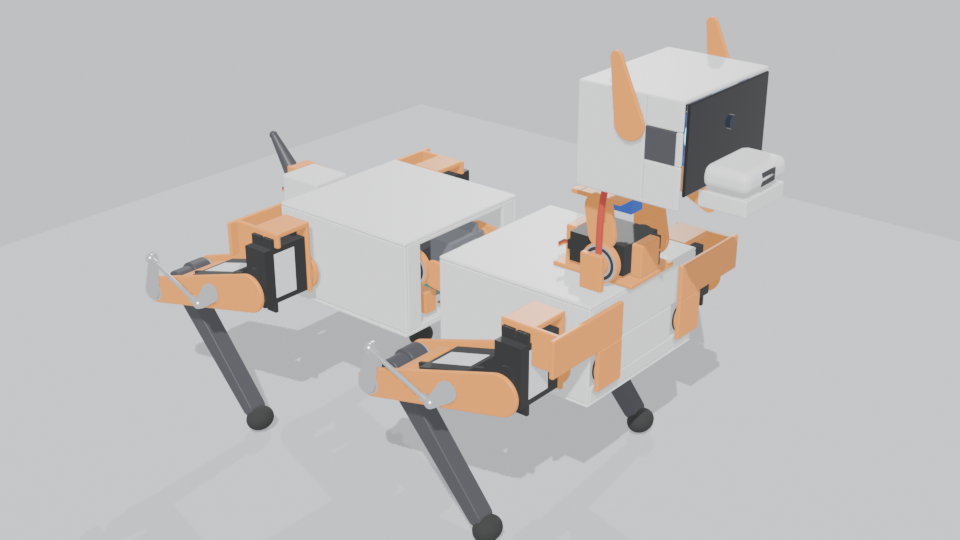 | 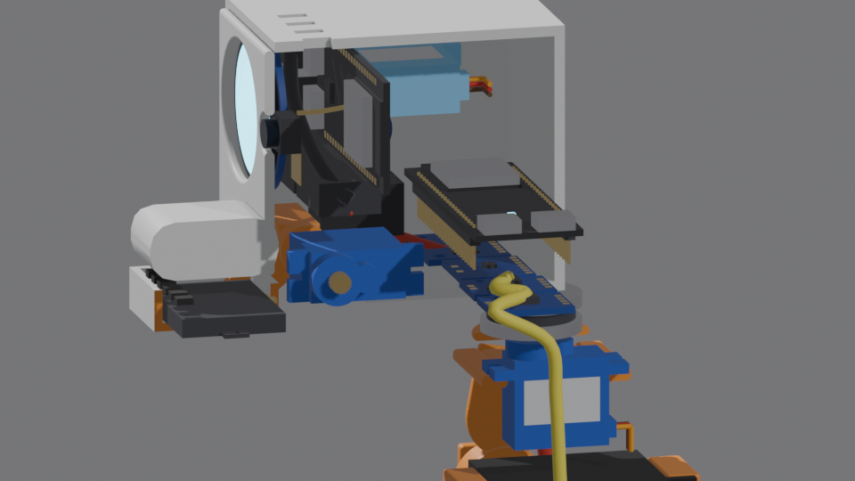 |

### Питание

```
2S2P Molicel P28A + BMS 2S 40 А ─ предохранитель 40 А ─ XT60 loop-key (выключатель)
  ├─ 25 А ─ UBEC 6 В 20 А ─ передние ноги, шея, челюсть, уши
  ├─ 25 А ─ UBEC 6 В 20 А ─ задние ноги, позвоночник, хвост
  └─  5 А ─ DC-DC 5 В 5 А ─ все платы ESP32, экраны, звук, датчики
```

| Режим | Ток батареи | Время |
|---|---:|---:|
| Ходьба | 7.7 А | ≈ 37 мин |
| Стоит | 4.0 А | ≈ 72 мин |
| Лежит | 0.8 А | ≈ 5.8 ч |
| Пик (вставание) | 25.8 А | — |

Подробно — [`docs/power.md`](docs/power.md).

### Разнесённый вид

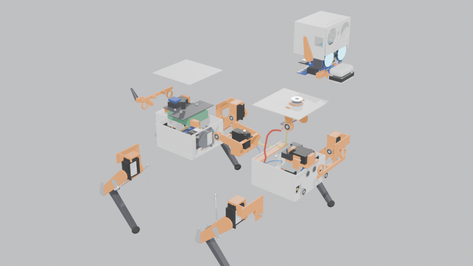

---

## Как менялась модель

| v1 — схема | v2 — кинематика | v3 — первый облик | v6 — сейчас |
|---|---|---|---|
| 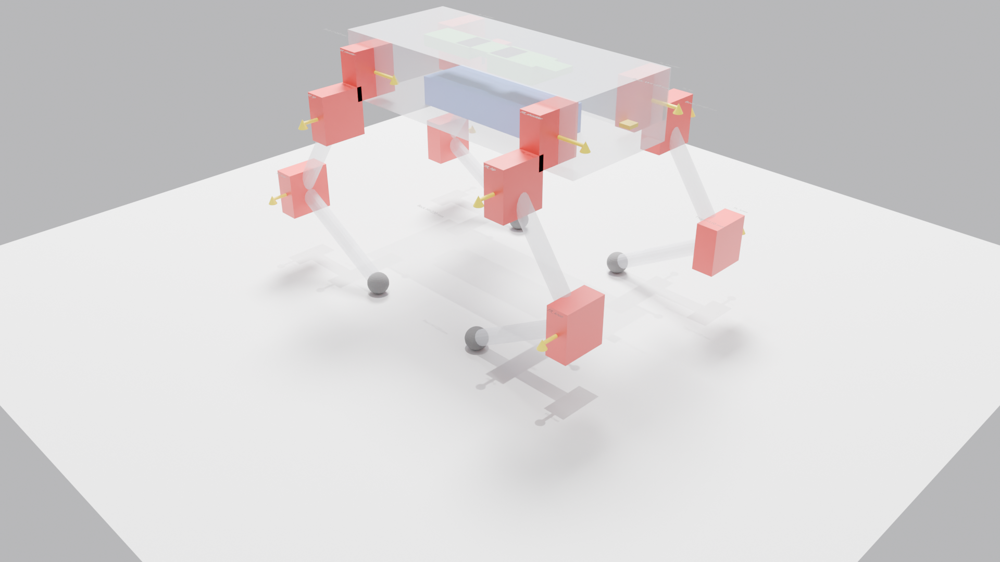 | 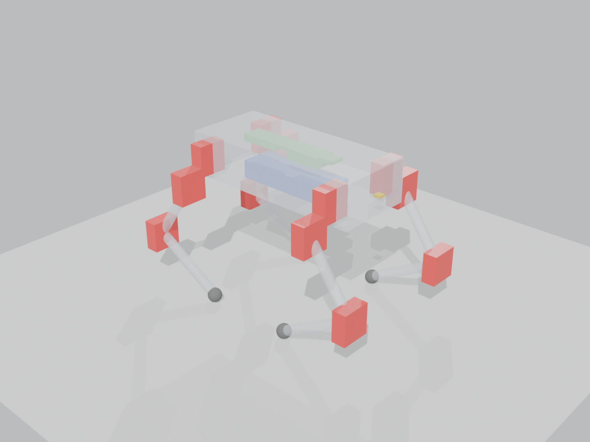 | 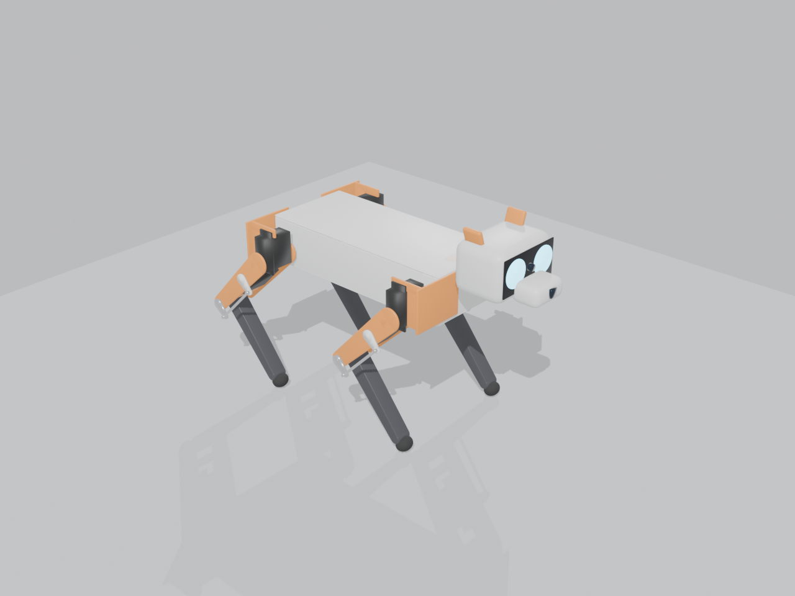 |  |

---

## Сборка модели

Модель целиком собирается скриптами — в `.blend` руками ничего не правится.
Нужен Blender 5.0.

```bash
B=/path/to/blender
$B --background --python scripts/build_v6.py                              # модель → robodog_v6.blend
$B --background robodog_v6.blend --python scripts/v6_poses.py             # позы и проверка пересечений
$B --background robodog_v6.blend --python scripts/v6_calc.py              # масса, ЦМ, запасы, токи → docs/
$B --background robodog_v6.blend --python scripts/v6_stage2.py            # подписи и слой Servo_map
$B --background robodog_v6.blend --python scripts/v6_render_servo_map.py  # карта серв, разнесённый вид
$B --background robodog_v6.blend --python scripts/v6_render_readme.py     # картинки для README
```

| Путь | Что там |
|---|---|
| `params.json` | все размеры, таблица серв, электроника, питание, колено, пружина |
| `scripts/v6lib/` | модули модели: `layout` (размеры и оси), `servo`, `rig`, `parts_*`, `boards`, `cable`, `checks` |
| `scripts/v6_*.py` | позы, расчёты, документы, рендеры |
| `docs/` | `servo_map`, `engineering`, `knee_linkage`, `power`, `nervous_system`, `sim_params` |
| `renders/` | все картинки |
| `robodog_v6.blend` | готовая модель; слой `Servo_map` — с подписями |
